  

  

  
  
  
  
  

## 🔬 About me

I'm a **Computer Vision and AI researcher** and a B.Tech Computer Science & Business Systems student at **Bannari Amman Institute of Technology** (CGPA 8.7). My work is about teaching models to understand images when labelled data is scarce: **unsupervised deep clustering**, **OCR on degraded, real-world documents**, and **object detection**. I've published at IEEE and ship every model as a live demo.

| | |
|---|---|
| 🔭 **Research interests** | Computer vision · Unsupervised & self-supervised learning · Deep clustering · OCR & document image analysis · Object detection · Retrieval-augmented generation |
| 🌱 **Currently** | Character recognition with YOLO *(paper in preparation)* · Character recognition in historical inscription images |
| 🎯 **Looking for** | Research internships in computer vision and deep learning |

## 📄 Publications

> **Unsupervised Clustering of Tamil Handwritten Vowel and Consonant Characters Using HOG Features** 
> Madhumitha A, Adhish S G, **Ashvitta S**, Jude Athin V S · *IEEE, 2026 International Conference* 
> 
> 
> 

> **TamilHeritage-GPT: A Self-Augmenting Retrieval-Augmented Generation Framework for Multilingual Cultural Heritage Conversational AI** 
> K. Pandian et al., incl. **Ashvitta S** · *IEEE Conference, accepted* 
> 

> 📝 *In preparation:* character recognition with YOLO

## 🧪 Research projects

### ✍️ Unsupervised Handwritten Character Clustering · *IEEE published*
Recovers 31 character classes from 14,260 handwritten character images without being given a single label, and benchmarks seven clustering algorithms against each other. This is the work behind my IEEE paper. 

### 🧠 Deep Unsupervised Image Clustering
A deep learning model that groups handwritten images by visual similarity with no labels, so large unlabelled image collections can be organised automatically. Upload an image in the live demo and see which cluster it lands in. 

### 📜 Olaisuvadi · Tamil Palm-Leaf Manuscript Annotation Tool
An annotation tool for ancient Tamil palm-leaf manuscripts. It splits degraded, low-contrast scans into lines and characters so each character can be labelled quickly, and I used it to annotate a dataset of 30k+ characters. 

### 🪨 Inscription Image Annotation Tool
A browser tool for drawing character-level bounding boxes on stone-inscription photographs and labelling each one. It builds the detection dataset for my ongoing recognition work. 

### 🏛️ TamilHeritage-GPT · *IEEE accepted*
A bilingual retrieval-augmented generation (RAG) assistant for heritage tourism. When it can't find an answer, it adds to its own knowledge base. 

## 🤖 Applied AI · live demos

| Project | What it does | Links |
|---|---|---|
| **Face Emotion Detection** | Recognises facial emotions from images. | [Demo](https://huggingface.co/spaces/Ashvitta07/Face-Emotion-Detection) · [Code](https://github.com/AshvittaS/Emotion-Face-detection) |
| **Text Emotion Detection** | Detects the emotion in a piece of text with a fine-tuned BERT. | [Demo](https://huggingface.co/spaces/Ashvitta07/Text_Emotion_detection) · [Code](https://github.com/AshvittaS/Emotion_text_detection) |
| **Fake News Classifier** | Flags news articles as real or fake. | [Demo](https://huggingface.co/spaces/Ashvitta07/Fake_news_classifier) · [Code](https://github.com/AshvittaS/Fake-news-classification) |
| **Spam or Not Spam** | Detects spam in SMS and email text. | [Demo](https://huggingface.co/spaces/Ashvitta07/Spam_or_not_Spam) · [Code](https://github.com/AshvittaS/spam_detection) |
| **Intel Image Classification** | Classifies natural scenes (buildings, forest, sea…). | [Demo](https://huggingface.co/spaces/Ashvitta07/Intel-image-classification) · [Code](https://github.com/AshvittaS/Intel-image-CNN) |
| **Sign Language Detection** | Recognises sign-language hand gestures. | [Code](https://github.com/AshvittaS/Sign_language_detection) |
| **Poem Generator** | Writes poems with a fine-tuned GPT-2. | [Code](https://github.com/AshvittaS/Poem_generator) |
| **ClauseCite** | Legal AI for contract analysis, agreement drafting and Indian statutory research. | [Code](https://github.com/AshvittaS/ClaudeCite) |

<a href="https://huggingface.co/Ashvitta07/spaces">See all 18 Hugging Face Spaces →</a>

## 🛠️ Tech stack

   
  

  
  
  
  
  
  
  
  
  
  

## 💼 Experience

**Researcher** · Tamil Computational and Sensor Technology Lab, BIT · *Dec 2025 – Oct 2026* 
OCR for degraded palm-leaf manuscript images: built a 30k+ character dataset, restored low-contrast scans and trained a CNN recognition model. The lab has since closed, and I'm continuing the research on my own.

**AI Workforce** · College AI Training Initiative, BIT · *Jun 2025 – Dec 2025*

## 🏆 Achievements

| | Result | Event |
|---|---|---|
| 🥇 | **First Prize** | [E-HORYZON 2K26 Startup Pitch: *"Why Not Tamil?"*](https://www.linkedin.com/posts/ashvitta_whynottamil-tamil-tamilheritage-activity-7431590349480845312-OpDv/) · Kongu Engineering College |
| 🥇 | **First Place** | [Hacksprint 2.0, national-level hackathon](https://www.linkedin.com/posts/ashvitta_hacksprint2-firstplace-hackathonjourney-activity-7422208583536156672-JhsU/) · Karpagam Academy of Higher Education |
| 🥇 | **First Prize** | [Mobility 2.0, national hackathon](https://www.linkedin.com/posts/ashvitta_mobility2-iot-deeplearning-activity-7377973362851098624-ZvCq/) |
| 🥇 | **First Place** | [SheHacks'25, 24-hour hackathon](https://www.linkedin.com/posts/ashvitta_shehacks25-ieee-womenintech-activity-7333513859393011714-m-At/) · IEEE KPRIET WIE |
| 🎯 | **Shortlisted** | [Synaptix Frontier AI Hack, IIT Madras (Shaastra 2026)](https://www.linkedin.com/posts/ashvitta_synaptixaihack-iitmadras-shaastra2026-activity-7409950057438818304-8Buc/) |
| 🥉 | **2nd Runner-Up** | [HackXelerate'26](https://www.linkedin.com/posts/ashvitta_hackathon-hackxelerate-growthjourney-activity-7454486919184482304-uLke/) · KPR Institute of Engineering and Technology |

**Leadership**

- 👩‍💼 **Chairperson, IEEE Women in Engineering (WIE)**, IEEE BIT Student Branch · *Jan 2025 – Jun 2026*
- ⚡ **Chairperson, IEEE Power Electronics Society (PELS)**, IEEE BIT Student Branch · *2026*

## 📊 GitHub activity

  
  
  

  

<picture>
  <source media="(prefers-color-scheme: dark)" srcset="https://raw.githubusercontent.com/AshvittaS/AshvittaS/output/github-snake-dark.svg"/>
  <source media="(prefers-color-scheme: light)" srcset="https://raw.githubusercontent.com/AshvittaS/AshvittaS/output/github-snake.svg"/>
  
</picture>

  

